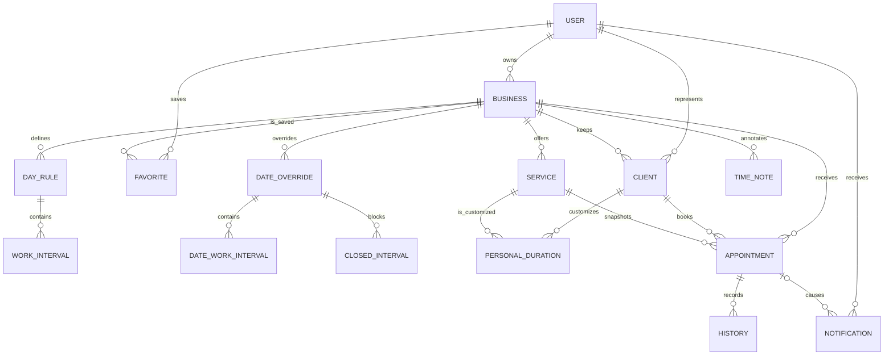

# Задание 2. Microsoft SQL Server-адаптер и схема данных Notebook

## Цель

Заменить временное JSON-хранилище полноценным адаптером Microsoft SQL Server, не изменяя
Telegram-обработчики и бизнес-правила. Приложение должно продолжить работать через
существующие интерфейсы `Repository` и `Transaction`.

Результат включает настройку SQL Server Developer и SSMS, ORM-модели, миграции,
преобразование ORM-строк в Pydantic-модели и обратно, ограничения, индексы,
конкурентные транзакции, интеграционные тесты и инструкцию запуска без секретов.

Черновая расширенная модель продукта находится в `docs/MAX бот концепт v0.2.md`.
Она служит контекстом, но не является окончательной схемой текущего MVP. Источником
контракта первой миграции являются `src/notebook_bot/models.py`, конкретные требования
этого задания и поведение существующих тестов.

## Выбранный технический стек

Для этой ветки зафиксирован один совместимый набор:

- SQL Server 2022 Developer или новее для разработки и тестов;
- SQL Server Management Studio для управления локальным экземпляром;
- Microsoft ODBC Driver 18 for SQL Server;
- SQLAlchemy 2.x с асинхронным API;
- `aioodbc` как асинхронный диалект SQLAlchemy поверх `pyodbc`;
- Alembic для миграций;
- Pydantic-модели из `src/notebook_bot/models.py` как внешний контракт;
- pytest и pytest-asyncio для тестов;
- Ruff для статической проверки.

Предлагаемые диапазоны новых зависимостей:

```text
SQLAlchemy>=2.0,<3
aioodbc>=0.5,<1
pyodbc>=5,<6
alembic>=1.14,<2
```

Версии требуется проверить с текущей Python и зафиксировать в `requirements.lock.txt`.
Microsoft ODBC Driver устанавливается в Windows отдельно и не заменяется пакетом pip.
Не смешивать в одном адаптере `aioodbc` с другим SQLAlchemy-диалектом или LocalDB-файлом.
Переход на другую СУБД является отдельным архитектурным решением.

## Сначала изучить

- `src/notebook_bot/models.py` — модели, которые получает и возвращает логика;
- `src/notebook_bot/repository.py` — методы Repository и Transaction;
- `src/notebook_bot/storage.py` — поведение временного адаптера и откат;
- `src/notebook_bot/logic/catalog.py` — фактически используемые фильтры;
- `src/notebook_bot/logic/availability.py` — чтения при расчёте доступности;
- `src/notebook_bot/logic/booking.py` — границы операций записи и переноса;
- `src/notebook_bot/main.py:build_app()` — точка подключения;
- `tests/test_storage.py`, `tests/test_booking.py`, `tests/test_two_businesses.py`;
- раздел 24 продуктового концепта и описание границ MVP в README.

Не переносить расчёт слотов в SQL, ORM-модели или Telegram-обработчики. База отвечает
за хранение, целостность, блокировки и атомарность. Правила доступности остаются в
`logic/availability.py`.

## Рабочая зона

```text
src/notebook_bot/database/models.py
src/notebook_bot/database/repository.py
src/notebook_bot/database/db.py
src/notebook_bot/database/mappers.py       # если потребуется отдельное преобразование
src/notebook_bot/database/exceptions.py    # только после согласования ошибок адаптера
alembic.ini
alembic/
tests/database/
.env.example
pyproject.toml
requirements.lock.txt
docs/DATABASE_SETUP.md
```

`src/notebook_bot/models.py` и `src/notebook_bot/repository.py` являются общими
контрактами. Не менять их самостоятельно ради удобства ORM. Необходимое изменение
контракта сначала описывается в pull request со списком затронутых потребителей.

## Контракт адаптера

`database/db.py:create_repository()` возвращает объект `Repository` при
`STORAGE=database`.

`Repository.transaction()` возвращает асинхронный контекстный менеджер. Внутри него
одна SQL-транзакция и одна AsyncSession предоставляют:

- `get(model, id)` — одну Pydantic-модель или `None`;
- `list(model, **filters)` — список Pydantic-моделей по равенству полей;
- `put(entity)` — добавление или обновление по ID;
- `delete(model, id)` — удаление с соблюдением связей.

При нормальном выходе выполняется commit, при исключении — rollback. Сессию, ORM-объект
или незавершённый запрос нельзя возвращать за пределы блока.

`list()` должен поддерживать все фильтры, которые реально передаёт логика. Перед
реализацией собрать вызовы `tx.list(` поиском по проекту. Нельзя строить SQL из
непроверенного имени поля; разрешённые модели и фильтры отображаются на известные ORM-поля.

## Настройка SQL Server Developer и SSMS

Адрес подключения читается только из локальной переменной:

```text
DATABASE_URL=mssql+aioodbc://<user>:<password>@<server>/<database>?driver=ODBC+Driver+18+for+SQL+Server
```

В GitHub хранится пример без настоящего пароля. `.env`, дампы, сертификаты и каталог
данных SQL Server не добавляются в репозиторий. Параметры URL должны кодироваться
корректно; строку с настоящим паролем нельзя приводить в журнале или pull request.

Для разработки создать отдельно:

- отдельный login/user приложения либо согласованную Windows Authentication;
- базу `NotebookDev` для ручной разработки;
- базу `NotebookTest` только для автоматических тестов;
- минимальные права приложения на схему `dbo` или отдельную схему приложения;
- административную учётную запись только для установки и миграций.

Приложение не запускается постоянно от `sa` или учётной записи администратора.
Учётная запись миграций может менять схему; обычной учётной записи достаточно чтения
и изменения данных в уже созданных таблицах.

### Минимальная работа в SSMS

1. Установить SQL Server Developer как Database Engine и отдельно установить SSMS.
2. Записать имя созданного экземпляра SQL Server; SSMS является интерфейсом, а не самой БД.
3. Подключиться через Windows Authentication и проверить версию сервера.
4. Создать отдельные `NotebookDev` и `NotebookTest` либо подготовить права для их создания.
5. Создать login/user приложения и выдать только необходимые права.
6. Применить Alembic к обеим пустым базам. Таблицы вручную через конструктор SSMS не создавать.
7. Через Object Explorer проверить таблицы, ключи, constraints, индексы и таблицу версии Alembic.
8. Через New Query выполнять только диагностические SELECT и согласованные команды настройки.
9. Никогда не запускать очистку или тесты, пока в строке подключения указана `NotebookDev`.

SQL Server Object Explorer в Visual Studio разрешено использовать для просмотра тех же
объектов. Источником схемы остаются миграции Alembic, поэтому изменения через графический
редактор SSMS или Visual Studio не считаются изменением проекта.

В настройке SQLAlchemy проверить:

- `pool_pre_ping=True` для обнаружения разорванных соединений;
- ограниченный размер пула;
- отключённый вывод SQL с параметрами в обычном режиме;
- закрытие engine при остановке приложения;
- строку подключения `mssql+aioodbc` и установленный ODBC Driver 18;
- параметры шифрования и доверия сертификату для локальной и рабочей среды;
- хранение aware datetime как `datetimeoffset`;
- отсутствие `metadata.create_all()` при обычном запуске.

Схему создают и изменяют только миграции Alembic. В `docs/DATABASE_SETUP.md` описать
установку SQL Server Developer, SSMS и ODBC Driver 18, экземпляр сервера, базы, учётные
записи, миграции, тесты, `STORAGE=database` и возврат к JSON.

## Идентификаторы и типы

Текущий `new_id()` возвращает 16 шестнадцатеричных символов, хотя концепт использует UUID.
Первая SQL-версия сохраняет текущий строковый контракт. Переход на полный UUID требует
отдельной миграции моделей, callback и существующих JSON-данных.

| Python | SQL Server | Ограничение |
|---|---|---|
| строковый ID | `varchar(16)` или более широкий varchar | primary/foreign key |
| `telegram_id` | `bigint` | unique, not null |
| `date` | `date` | локальная дата |
| aware `datetime` | `datetimeoffset` | не возвращать naive datetime |
| минуты дня | `smallint` | от 0 до 1440 |
| длительность | `integer` | положительное значение |
| цена в рублях | `integer` | неотрицательное значение |
| логическое поле | `bit` | not null и явный default |
| пользовательский текст | `nvarchar` | сохранять русский текст без потерь |
| ограниченный статус | `varchar` и CHECK | только известные значения |

Цена сейчас хранится целым количеством рублей. Денежную модель нельзя незаметно менять
на копейки или `numeric`: это отдельное решение продукта и API.

## Обязательные сущности первой миграции

### users

Один Telegram-пользователь может быть клиентом и владельцем до двух бизнесов.

- `id` — primary key;
- `telegram_id` — bigint, not null, unique;
- `name` — not null.

Один User владеет Business, сохраняет Favorite, может иметь Client в разных бизнесах,
создаёт History и получает Notification.

### businesses

Поля соответствуют `Business`: владелец, публичный код профиля, название, специалист,
описание, формат, адрес, общий комментарий, приём новых записей, буфер, кратность времени,
минимальный срок, горизонт, сроки отмены/переноса и реквизиты.

- `owner_id` → users.id, not null;
- `owner_id` не unique: допускаются два бизнеса;
- `public_code` — not null и unique; хранится в нормализованном виде и не совпадает
  с внутренним `id` или Telegram ID;
- индекс по `owner_id` обязателен;
- Business имеет Service, DayRule, DateOverride, TimeNote, Client и Appointment.

Лимит двух бизнесов нельзя выразить CHECK одной строки. Проверка количества и вставка
выполняются в одной защищённой транзакции. Параллельные запросы не должны создать третий.

Контракт `public_code` вводится заданием 3. Ветка адаптера должна получить актуальный
`models.py` после объединения этого контракта либо согласовать порядок миграций заранее.

### services

Поля: business, название, цена, режим длительности, длительность по умолчанию,
активность и предоплата.

- foreign key на businesses;
- цена, предоплата и длительность проходят CHECK;
- предоплата не больше цены;
- режим только `fixed` или `personal`;
- удаление в интерфейсе выполняется через `active=false`.

### day_rules и work_intervals

DayRule хранит business, weekday, дневной лимит и комментарий. Список интервалов
нормализуется в дочернюю таблицу.

- unique `(business_id, weekday)`;
- weekday от 0 до 6;
- limit null или неотрицательный;
- 0 ≤ start < end ≤ 1440;
- внешний ключ интервала на day_rules;
- дочерние интервалы можно удалять каскадно при удалении родительского правила.

Пересечение интервалов одного правила проверяется существующей Python-логикой и тестами;
база дополнительно защищает корректность каждой пары границ.

### date_overrides, date_work_intervals и closed_intervals

DateOverride хранит разовое правило одного Business на одну дату. Рабочие и закрытые
интервалы представляются дочерними строками.

- unique `(business_id, day)`;
- `intervals=None` означает наследовать неделю;
- пустой список означает явно не задавать рабочих интервалов;
- `limit_override=false` означает наследовать лимит;
- `limit_override=true`, `limit=null` означает снять лимит на дату;
- `day_off`, комментарий и адрес относятся только к этой дате;
- несколько закрытых интервалов разрешены;
- причина закрытия не обязательна;
- границы интервалов проходят те же CHECK.

Для различия `None` и пустого списка нужен явный признак переопределения либо другая
однозначная схема: отсутствие дочерних строк само по себе эти состояния не различает.

### time_notes

Комментарий и адрес конкретного времени в конкретном Business.

- foreign key `business_id`;
- unique `(business_id, day, minute)`;
- minute от 0 до 1439;
- правило приоритета адреса остаётся в сервисной логике.

### clients

Client — карточка внутри бизнеса, а не глобальная роль. Один User получает разные Client
в двух бизнесах.

- `business_id` → businesses.id;
- `user_id` → users.id, nullable для ручной карточки;
- имя и частная заметка;
- filtered unique `(business_id, user_id)` с условием `user_id IS NOT NULL`;
- несколько ручных карточек с `user_id=null` разрешены.

### personal_durations

Персональная длительность связывает Client и Service.

- unique `(client_id, service_id)`;
- minutes > 0;
- Client и Service принадлежат одному Business.

Отдельные внешние ключи не доказывают общий Business. Для tenant-защиты допускается
DB-only `business_id` и составные внешние ключи либо другая согласованная схема. Наружу
по-прежнему возвращается текущая Pydantic-модель.

### appointments

Appointment связывает Business, Client и Service и хранит начало, длительность, снимки
услуги, статус, снимок буфера, предоплату, оплату, срок резерва, запрос переноса,
требуемую длительность, revision и отправленные напоминания.

- все три ссылки существуют и принадлежат одному Business;
- duration_min > 0;
- цена, предоплата и buffer_min неотрицательны;
- статусы входят в перечень `Appointment`;
- revision неотрицателен;
- aware datetime хранится как `datetimeoffset`;
- снимки не меняются после изменения Service.

`reminders_sent` предпочтительно хранить в дочерней таблице. Допускается JSON в
`nvarchar(max)` с `ISJSON` CHECK, если адаптер прозрачно собирает текущий список строк.
В SQL Server нет типа ARRAY. Отдельную публичную модель Reminder без изменения общего
контракта не добавлять.

Unique `(business_id, start)` недостаточно: две записи с разным началом могут пересекаться
по длительности и буферу. Доступность проверяется логикой внутри защищённой транзакции.

### histories

История содержит Appointment, User-инициатора, действие, время, старое и новое начало,
причину. История не переписывается при изменении текущей записи. Время — `datetimeoffset`.

### favorites

- unique `(user_id, business_id)`;
- внешние ключи на users и businesses;
- повторное событие не создаёт дубликат.

### notifications

Очередь исходящих сообщений: User, текст, необязательная Appointment, флаг отправки,
попытки и следующая попытка.

- attempts ≥ 0;
- Notification сохраняется в транзакции породившего события;
- при нескольких worker одно сообщение нельзя захватить дважды;
- выбор очереди должен иметь отдельный конкурентный тест.

## Сущности концепта вне первой миграции

В концепте есть `BusinessProfile`, `ServiceCategory`, `AppointmentItem`, `Payment`,
`Reminder`, `Review`, `WaitlistEntry`, `ClientPass`, `PromoCode`, `BusinessSubscription`.
Пустые таблицы на будущее не создаются:

- профиль сейчас входит в Business;
- Appointment содержит одну услугу и снимки;
- предоплата хранится в Appointment;
- напоминания представлены Notification и `reminders_sent`;
- отзывы, лист ожидания, абонементы, промокоды и подписка не входят в MVP.

Они добавляются отдельными миграциями после появления утверждённых моделей и сценариев.

## Связи и tenant-изоляция



Каждый запрос бизнес-сущности ограничивается `business_id`, если контекст известен.
`owner_id` недостаточен: у владельца два независимых бизнеса.

Проверить, что Service и Client первого бизнеса нельзя использовать в Appointment или
PersonalDuration второго, расписания не смешиваются, выбор записей мастера ограничен
business_id, одинаковое время двух бизнесов разрешено и знание ID не предоставляет права.

Tenant-изоляцию совместно обеспечивают сервисная логика, фильтры репозитория, внешние
ключи и составные ограничения. Проверки только в Telegram callback недостаточно.

## Ограничения данных

Применить:

- PRIMARY KEY для каждой сущности;
- NOT NULL для обязательных полей;
- FOREIGN KEY для связей;
- UNIQUE и filtered unique indexes для перечисленных ключей;
- CHECK для диапазонов, статусов, цены, длительности, времени и weekday;
- server default только там, где он совпадает с Pydantic default;
- RESTRICT для данных, от которых зависят записи и история;
- CASCADE только для технических интервалов родительского правила.

Ограничение БД дополняет Pydantic и бизнес-логику. Его нарушение откатывает всю транзакцию.

## Транзакции и уровни изоляции

### Какие гонки требуется предотвратить

Два процесса могут одновременно увидеть свободный слот или место в дневном лимите и
оба создать Appointment. Та же гонка возможна при создании второго бизнеса.

### Оценка уровней

- Read Uncommitted не использовать: грязное чтение недопустимо для слотов и лимитов.
- Read Committed является исходным уровнем, но без блокировки не защищает операцию
  «прочитать доступность, затем вставить».
- Repeatable Read удерживает больше блокировок, но без правильного порядка может увеличить
  число взаимных блокировок и не заменяет защиту бизнес-ресурса.
- Snapshot использует версионность строк и требует настройки базы; конфликт записи всё равно
  должен обрабатываться явно.
- Serializable является самым строгим уровнем, но увеличивает блокировки и риск deadlock.

Для первой версии требуется выбрать один способ и доказать его тестами. Совместимый с
текущим контрактом исходный вариант — Read Committed плюс `sp_getapplock` с владельцем
`Transaction`, полученный до чтений логики. Простейший корректный этап — общий ресурс
блокировки операций Repository. Он ограничивает параллельность, но подходит нагрузке MVP.

Возвращаемый код `sp_getapplock` требуется проверить. Тайм-аут, deadlock и отказ получения
блокировки не считаются успешным входом в транзакцию. Блокировка освобождается вместе с
commit или rollback; ручное освобождение не должно происходить раньше завершения операции.

Для создания бизнеса блокировка должна объединять операции owner_id; для записи,
переноса и графика — business_id. Переход к узким блокировкам требует явного способа
передать ключ до первого чтения и согласованного изменения контракта.

Не держать SQL-транзакцию во время ожидания пользователя или Telegram API. Она охватывает
одну завершённую сервисную операцию.

## Обработка ошибок и исключений

На уровне Python различать:

- ожидаемый `RuleError` бизнес-правила;
- `IntegrityError` SQLAlchemy;
- `OperationalError`/`DBAPIError` соединения;
- serialization failure или deadlock;
- несовместимую миграцию;
- ошибку программирования, которую нельзя скрывать.

Адаптер выполняет rollback и освобождает сессию. Не использовать пустой `except`, не
возвращать частичные данные и не показывать пользователю SQL, параметры, пароль или
персональные сведения. Сбой соединения нельзя выдавать за «время уже занято».

Текущая логика не требует хранимых процедур T-SQL. Не дублировать расчёт слотов
процедурами или триггерами. CHECK, UNIQUE и FOREIGN KEY сами вызывают SQL-ошибки.
Собственный `THROW` допускается только для согласованного ограничения, которое невозможно
выразить constraint; такой объект включается в Alembic и покрывается тестом.

Если миграции или служебная процедура используют T-SQL, корректно применять
`BEGIN TRY / BEGIN CATCH`, `XACT_STATE()`, `ERROR_NUMBER()` и `THROW`. `@@ERROR` относится
только к предыдущему выражению и не должен быть основным механизмом обработки ошибок.
На уровне Python анализировать SQLSTATE и native error number из исключения `pyodbc`.
Пользовательский текст связывать с типом ошибки и именем собственного constraint, а не
с полным сообщением SQL Server.

## Индексы

Минимальный набор для текущих запросов:

- businesses `(owner_id)`;
- businesses `(public_code)` — unique;
- services `(business_id, active)`;
- appointments `(business_id, start)`;
- appointments `(client_id, start)`;
- appointments `(business_id, status, start)`;
- day_rules `(business_id, weekday)` — unique;
- date_overrides `(business_id, day)` — unique;
- time_notes `(business_id, day, minute)` — unique;
- clients `(business_id, user_id)` — filtered unique для ненулевого user_id;
- notifications `(sent, next_attempt)`;
- histories `(appointment_id, at)`;
- favorites `(user_id, business_id)` — unique.

Индексы подтверждаются запросами логики. Индекс на каждую колонку не добавляется.

## Alembic и миграции

1. Настроить Alembic для async SQLAlchemy и ORM metadata.
2. Первая миграция создаёт минимальную схему с именованными constraints и индексами.
3. `upgrade` применяется к пустой базе без ручных действий.
4. `downgrade` удаляет только объекты приложения в обратном порядке.
5. Каждое следующее изменение получает новую миграцию.
6. Автогенерация просматривается вручную.
7. Приложение не запускает миграции автоматически.
8. CI применяет `alembic upgrade head` к пустой тестовой базе.

## Тестирование

Тесты адаптера запускаются на SQL Server Developer, а не SQLite или LocalDB-файле:
`sp_getapplock`, filtered index, `datetimeoffset` и конкуренция зависят от СУБД.

### Контрактные тесты

Проверить put/get/list/delete, фильтры, commit, полный rollback, обновление по ID,
преобразование всех Pydantic-моделей, отсутствие живых ORM-объектов снаружи и aware datetime.

### Ограничения

Проверить каждую unique, foreign key и check-гарантию. После ошибки не должны частично
сохраняться History или Notification.

### Конкурентные тесты

Использовать два независимых соединения или AsyncSession:

- из двух пересекающихся Appointment проходит одна;
- дневной лимит нельзя превысить;
- параллельное создание не даёт третий Business;
- параллельная генерация публичного кода не создаёт дубликат;
- изменение расписания не удаляет существующую Appointment;
- два worker не захватывают одну Notification;
- операция первого Business не изменяет второй.

`asyncio.gather()` поверх одной сессии не доказывает межпроцессную защиту.

### Сценарные тесты

Запустить общие сценарии с SQL-адаптером: User, два Business, разные Service и расписания,
Client, Appointment, PersonalDuration, перенос, отмена, Notification и повторное чтение
новым экземпляром Repository. Тесты подключаются только к отдельной тестовой базе.

## Порядок выполнения

1. Создать ветку `feature/sql-server-adapter` от актуального `main`.
2. Подготовить `docs/DATABASE_SETUP.md` и переменные без секретов.
3. Добавить зависимости отдельным commit.
4. Описать ORM-модели, связи, constraints и индексы.
5. Создать первую миграцию Alembic.
6. Реализовать ORM ↔ Pydantic преобразование.
7. Реализовать Transaction и Repository.
8. Подключить `create_repository()` без изменений Telegram-модулей.
9. Добавить контрактные и конкурентные тесты SQL Server.
10. Запустить общие тесты отдельно с JSON и SQL Server.
11. Проверить сценарий после перезапуска бота.
12. Открыть pull request с инструкцией и описанием блокировки.

## Официальные справочные материалы

- SQL Server Developer и загрузки: https://www.microsoft.com/en-us/sql-server/sql-server-downloads
- Первое подключение через SSMS: https://learn.microsoft.com/en-us/ssms/quickstarts/ssms-connect-query-sql-server
- Диалект SQLAlchemy для SQL Server и `aioodbc`: https://docs.sqlalchemy.org/en/20/dialects/mssql.html#aioodbc
- `sp_getapplock`: https://learn.microsoft.com/en-us/sql/relational-databases/system-stored-procedures/sp-getapplock-transact-sql
- Блокировки и версии строк: https://learn.microsoft.com/en-us/sql/relational-databases/sql-server-transaction-locking-and-row-versioning-guide
- TRY/CATCH и состояние транзакции: https://learn.microsoft.com/en-us/sql/t-sql/language-elements/try-catch-transact-sql
- Alembic: https://alembic.sqlalchemy.org/en/latest/

## Критерии готовности

- пустая SQL Server-база создаётся миграцией;
- `STORAGE=json` продолжает работать;
- `STORAGE=database` запускает тот же бот;
- все текущие Pydantic-сущности сохраняются и восстанавливаются;
- rollback не оставляет частичных данных;
- конкуренция защищена между соединениями;
- третьему бизнесу нельзя появиться при гонке;
- два бизнеса изолированы;
- constraints и индексы находятся в миграции;
- время возвращается с часовым поясом;
- секреты, дампы и SQL-логи отсутствуют в commit;
- инструкция позволяет поднять тестовую БД с нуля;
- Ruff и все тесты проходят.

Не объединять ветку самостоятельно. В pull request указать схему, блокировку, уровень
изоляции, результаты миграций, тестов JSON/SQL Server и ограничения, оставленные логике.
