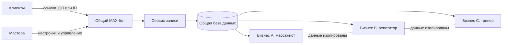
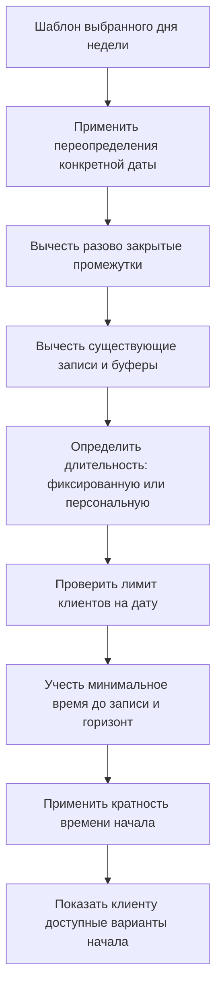
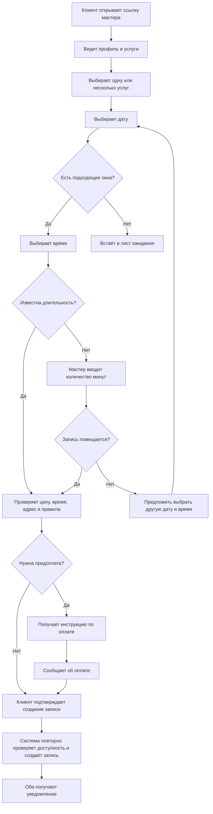
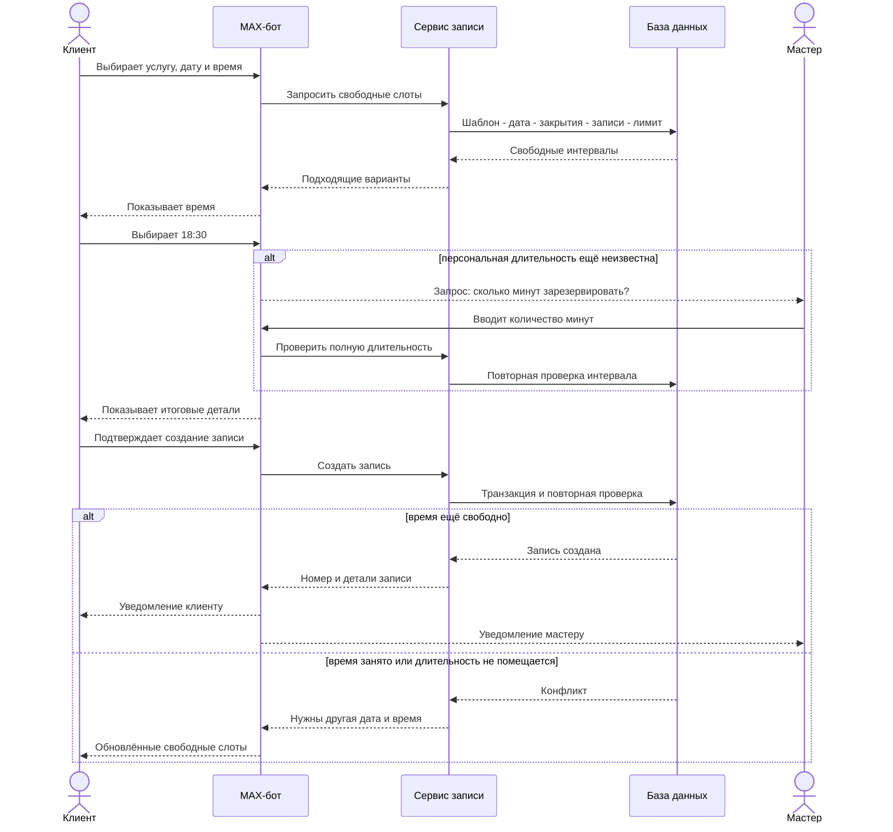
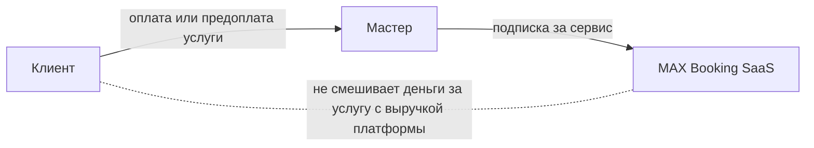
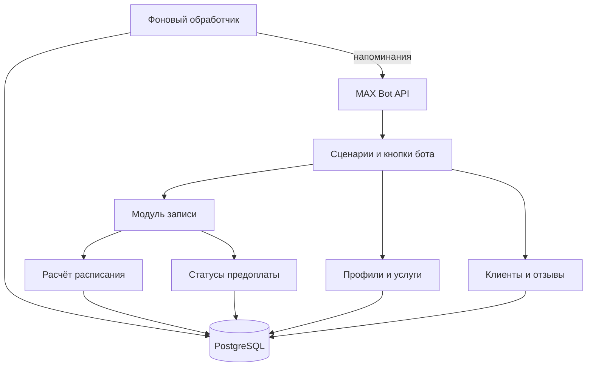

# MAX Booking SaaS — концепция сервиса онлайн-записи

> [!summary] Коротко
> **MAX Booking** — это общий бот в MAX, через который частные специалисты настраивают услуги и расписание, а клиенты самостоятельно выбирают свободное время, записываются, получают напоминания и управляют визитами. Один бот обслуживает много независимых бизнесов, но данные каждого мастера изолированы.

> [!important] Главная ценность
> Мы продаём не «ещё одного бота», а уменьшение ручной переписки: мастер реже отвечает на вопросы «когда свободно?», «куда приезжать?» и «можно перенести?», а клиент может записаться в удобное время без ожидания ответа.

> [!warning] Граница первой версии
> Это большой продукт. Если сразу делать CRM, автоматические платежи, абонементы, промокоды, красивое мини-приложение и аналитику, команда рискует не закончить ничего. Поэтому ниже функции разделены на **MVP**, **v1.5** и **v2**.

## Оглавление

- [[#1. Суть продукта|1. Суть продукта]]
- [[#2. Для кого мы делаем сервис|2. Для кого мы делаем сервис]]
- [[#3. Пользователь клиент и мастер|3. Пользователь, клиент и мастер]]
- [[#4. Один общий MAX-бот и multi-tenant архитектура|4. Общий бот и multi-tenant]]
- [[#5. Регистрация мастера|5. Регистрация мастера]]
- [[#6. Профиль бизнеса|6. Профиль бизнеса]]
- [[#7. Услуги и категории|7. Услуги и категории]]
- [[#8. Расписание недельный шаблон и исключения дат|8. Расписание]]
- [[#9. Адреса и комментарии к дням и времени|9. Адреса и комментарии]]
- [[#10. Как проходит запись|10. Как проходит запись]]
- [[#11. Перенос отмена и статусы записи|11. Перенос, отмена и статусы]]
- [[#12. Напоминание перед визитом и будущая настройка подтверждения|12. Напоминание и подтверждение]]
- [[#13. Напоминания|13. Напоминания]]
- [[#14. Предоплата и разделение денежных потоков|14. Предоплата и деньги]]
- [[#15. Лист ожидания|15. Лист ожидания]]
- [[#16. База клиентов и blacklist|16. Клиенты и blacklist]]
- [[#17. Отзывы|17. Отзывы]]
- [[#18. Клиентский кабинет|18. Кабинет клиента]]
- [[#19. Абонементы и промокоды|19. Абонементы и промокоды]]
- [[#20. Ограничения записи|20. Ограничения записи]]
- [[#21. Подписка SaaS|21. Подписка SaaS]]
- [[#22. Чем отличаемся от конкурентов|22. Конкуренты]]
- [[#23. План версий MVP v1.5 v2|23. План версий]]
- [[#24. Черновая модель данных|24. ER-диаграмма]]
- [[#25. Технические принципы|25. Технические принципы]]
- [[#26. Риски и открытые вопросы|26. Риски и вопросы]]
- [[#27. Что команда может сделать дальше|27. Следующие шаги]]

---

## 1. Суть продукта

Многие частные специалисты работают без администратора. Пока мастер занят с клиентом, он не может отвечать на сообщения. В результате запись ведётся в переписке, блокноте, заметках или нескольких календарях одновременно.

Типичные сообщения выглядят так:

> «Есть свободное окно в субботу?»  
> «Сколько длится услуга?»  
> «Можно перенести запись на вечер?»  
> «Напомните адрес».  
> «Я точно записан?»

Наш сервис переносит эти повторяющиеся действия в MAX:

1. Мастер один раз создаёт профиль, услуги и рабочий график.
2. Получает публичный код и ссылку на свой профиль.
3. Отправляет ссылку клиентам или размещает QR-код.
4. Клиент сам видит актуальные свободные окна.
5. Система создаёт запись и уведомляет обе стороны.
6. До визита бот отправляет напоминания с действиями «Перенести» и «Отменить».
7. После визита сохраняется история и появляется возможность оставить отзыв и/или записаться повторно.

### Что является продуктом

| Неудачная формулировка | Более точная формулировка |
|---|---|
| «Бот с кнопками» | Сервис самостоятельной записи клиентов |
| «Календарик внутри MAX» | Рабочее расписание с защитой от пересечений |
| «Форма заявки» | Настоящая запись, которая занимает конкретное время |
| «CRM со всеми функциями» | Сначала простой помощник частного специалиста |

### Как клиент попадает к мастеру

На старте мы **не строим каталог специалистов по городам**. Мастер сам приводит свою аудиторию по ссылке, QR-коду или короткому публичному ID.

```text
Ссылка / QR / ID мастера
            ↓
      общий MAX-бот
            ↓
  профиль нужного бизнеса
            ↓
          запись
```

Поэтому обязательный выбор города в MVP только удлинит путь. Вместо города полезнее хранить тип оказания услуги: у мастера, у клиента, онлайн или в переменном месте.

---

## 2. Для кого мы делаем сервис

Основная аудитория — люди и небольшие команды, которые работают по предварительной записи:

- массажисты, косметологи, парикмахеры, nail- и brow-мастера;
- тренеры, репетиторы, логопеды, психологи;
- фотографы и арендаторы небольших студий;
- консультанты и другие самозанятые специалисты;
- маленькие кабинеты и студии, которым ещё рано внедрять тяжёлую CRM.

> [!tip] Фокус на старте
> Для демонстрации лучше выбрать одну понятную нишу, например массажиста или репетитора. Архитектура при этом должна оставаться универсальной: ниши отличаются настройками, а не отдельными копиями программы.

### Проблемы мастера

| Проблема | Что делает сервис |
|---|---|
| Много одинаковых вопросов в личных сообщениях | Показывает услуги, цены и свободное время |
| Переносы теряются в переписке | Хранит новое время и историю переноса |
| Клиенты забывают о визите | Отправляет напоминания |
| Две записи попадают на одно время | Повторно проверяет слот и блокирует пересечение |
| Непонятно, кто давно не приходил | Хранит базу и историю визитов |
| Освободившееся окно пропадает | Предлагает его людям из листа ожидания |

### Проблемы клиента

| Проблема | Что делает сервис |
|---|---|
| Нужно ждать ответа мастера | Даёт записаться самостоятельно 24/7 |
| Ссылки разных мастеров теряются | Собирает любимых мастеров в одном кабинете |
| Неясно, где и когда встреча | Показывает время, адрес и комментарий к визиту |
| Нужно снова искать ту же услугу | Даёт кнопку «Записаться повторно» |
| Нет подходящих окон | Предлагает лист ожидания |

---

## 3. Пользователь клиент и мастер

В MVP нет отдельного выбора взаимоисключающей роли и нет разделения на «мастера» и «владельца бизнеса». Один пользователь MAX может быть клиентом, мастером или совмещать оба сценария. Например, человек ведёт занятия как репетитор и одновременно записывается к массажисту.

Главный экран строится вокруг задач пользователя:

```text
Главная

[ 📅 Мои записи ]
[ ⭐ Мои специалисты ]

Мой бизнес
[ 💼 Массаж у Анны ]
```

| Контекст | Основные возможности |
|---|---|
| **Как клиент** | Открывать профили специалистов, выбирать услугу, дату и время, переносить или отменять запись по правилам, получать напоминания, оставлять отзывы |
| **Как мастер** | Создавать и настраивать свой бизнес, услуги и расписание, вручную записывать клиентов, управлять записями и клиентской базой, проверять ручную предоплату |

Полноценные роли владельца, сотрудника и администратора появятся только тогда, когда сервис начнёт поддерживать студии и несколько сотрудников в одном бизнесе.

> [!note] Важное правило доступа
> Пользователь как клиент видит только собственные записи. В контексте своего бизнеса он видит только данные этого бизнеса. Если один человек участвует в нескольких бизнесах в будущих версиях, доступ проверяется отдельно для каждого бизнеса.

---

## 4. Один общий MAX-бот и multi-tenant архитектура

Мы создаём **одного общего бота**, а не отдельный код и отдельную базу для каждого мастера.



**Multi-tenant** простыми словами: приложение и база общие, но внутри всё разделено по «арендаторам» — бизнесам. В технической модели бизнес можно называть `tenant`.

Для каждой бизнес-записи хранится `tenant_id`:

```text
tenant_id = бизнес, которому принадлежат данные
```

Это поле должно быть у услуг, расписаний, записей, клиентских карточек, отзывов, промокодов и других бизнес-сущностей.

### Почему общий бот полезен

- мастер не создаёт и не настраивает отдельного бота;
- новые бизнесы подключаются регистрацией, а не копированием проекта;
- обновления устанавливаются сразу для всех;
- клиент видит записи к разным мастерам в одном кабинете;
- сервис можно продавать по подписке.

### Публичный идентификатор

Не стоит показывать наружу обычный номер строки из базы, например `business_id=184`.

Лучше создать отдельный случайный код:

```text
A7K29
```

и deep link вида:

```text
MAX → общий бот → бизнес с кодом A7K29
```

Так ссылка выглядит аккуратнее, а чужие профили нельзя просто перебирать по номерам.

---

## 5. Регистрация мастера

Мастер открывает бота и выбирает **«Я специалист»**.

### Предлагаемый онбординг

| Шаг | Что вводит мастер | Зачем это нужно |
|---:|---|---|
| 1 | Название бизнеса | Показываем в профиле и уведомлениях |
| 2 | Имя или имя специалиста | Клиент понимает, к кому записывается |
| 3 | Короткое описание | Объясняет специализацию и преимущества |
| 4 | Тип оказания услуг | У мастера, у клиента, онлайн или переменное место |
| 5 | Первая услуга | Название, цена, фиксированная или персональная длительность |
| 6 | Рабочая неделя | Дни, несколько интервалов, лимиты клиентов и комментарии |
| 7 | Правила записи | Когда можно записываться, переносить и отменять |
| 8 | Проверка профиля | Мастер видит результат глазами клиента |

После этого система выдаёт:

- публичный код;
- ссылку на профиль;
- в будущем — QR-код;
- подсказку, куда ссылку можно разместить.

> [!tip] Принцип онбординга
> Не требовать заполнить всё сразу. Для запуска достаточно профиля, одной услуги и расписания. Остальные настройки можно показать как чек-лист «Профиль заполнен на 60%».

---

## 6. Профиль бизнеса

Профиль — это публичная страница мастера внутри общего сервиса.

Пример содержимого:

```text
Массаж у Анны
Анна Петрова · массажист

⭐ 4,9 · 37 подтверждённых отзывов

О себе:
Спортивный и расслабляющий массаж, опыт 4 года.

Услуги:
• Массаж спины — 2 000 ₽ · 60 минут
• Общий массаж — 3 000 ₽ · 90 минут

[ Записаться ]  [ Отзывы ]  [ В избранное ]
```

### Поля профиля

- название бизнеса;
- имя мастера;
- описание;
- аватар или обложка — после MVP;
- способы связи;
- услуги, цены и длительность;
- обычный адрес или формат работы;
- общий комментарий для клиентов;
- правила отмены, переноса и опоздания;
- средняя оценка и подтверждённые отзывы;
- публичный код и ссылка.

Мастер должен иметь кнопку **«Посмотреть как клиент»**, чтобы проверить профиль перед отправкой ссылки.

Для MVP не нужны состояния `DRAFT`, `PUBLISHED` и `PAUSED`. Достаточно одной понятной настройки:

```text
Принимать новые записи: включено / выключено
```

При выключении профиль и уже созданные записи остаются доступны, но новые самостоятельные записи не создаются.

---

## 7. Услуги и категории

У услуги есть минимум пять полей:

| Поле | Пример |
|---|---|
| Название | Занятие с логопедом |
| Режим длительности | Фиксированная / персональная |
| Базовая длительность | 60 минут |
| Цена | 2 000 ₽ |
| Статус | Активна / скрыта |

Дополнительно можно хранить описание, подготовку к визиту, размер предоплаты, категорию и отдельный буфер между клиентами.

### Фиксированная и персональная длительность

При **фиксированной длительности** одна услуга всегда резервирует одинаковое количество времени. При **персональной длительности** цена и название услуги остаются общими, а время зависит от сочетания «клиент + услуга».

```text
Занятие с логопедом — 2 000 ₽

Алексей — 40 минут
Мария — 60 минут
Иван — 30 минут
```

Для нового или ещё неизвестного системе клиента используется такой сценарий:

1. Клиент выбирает услугу, дату и время начала из доступных вариантов.
2. Мастер получает запрос и вручную вводит количество минут в свободное поле, например `40` или `55`.
3. Система проверяет, помещается ли выбранная длительность до следующей записи, закрытого времени и конца рабочего интервала с учётом буфера.
4. Если помещается, запись создаётся, а значение сохраняется для этой услуги у этого клиента.
5. При следующей записи клиент сразу видит варианты начала, рассчитанные по сохранённой длительности.

Отдельные копии одной услуги для клиентов создавать не нужно. Персональная длительность хранится в связи между карточкой клиента и услугой.

Если мастер меняет длительность будущей записи, бот спрашивает область действия:

```text
Новая длительность: 60 минут

[ Только для этой записи ]
[ Использовать для следующих записей ]
```

Первый вариант меняет только снимок длительности в выбранной записи. Второй меняет выбранную запись и обновляет персональную длительность, которую система будет использовать при создании следующих записей этого клиента на эту услугу. Уже завершённые и ранее созданные другие записи автоматически не переписываются.

> [!warning] Длительность нельзя урезать автоматически
> Если запись не помещается из-за следующего клиента или другого ограничения, система сообщает о конфликте и предлагает перенести запись на другую дату и время. Вариант «сохранить максимально доступное количество минут» не используется.

### Категории

Если услуг 2–3, клиенту проще сразу показать их списком. Если прайс большой, мастер включает категории:

```text
Массаж
├── Массаж спины
├── Общий массаж
└── Спортивный массаж

Дополнительные услуги
├── Тейпирование
└── Консультация
```

Категория — необязательная. Услуга может существовать без неё.

### Несколько услуг в одной записи

В v1.5 клиент сможет выбрать несколько совместимых услуг:

```text
☑ Массаж спины — 60 минут — 2 000 ₽
☑ Тейпирование — 20 минут — 700 ₽

Итого: 80 минут, 2 700 ₽
```

Система ищет непрерывное окно на всю суммарную длительность. Цена и длительность сохраняются в записи как «снимок», чтобы старая история не изменилась после редактирования прайса.

> [!important] Правило совместимости
> Не все услуги можно объединять. Мастер должен иметь возможность запретить отдельные сочетания или указать, какие услуги разрешено добавлять как дополнительные.

---

## 8. Расписание недельный шаблон и исключения дат

Расписание строится слоями: обычная рабочая неделя задаёт повторяющиеся правила, а конкретная дата может разово их переопределить.

### 1. Обычная рабочая неделя

Для каждого дня недели мастер задаёт:

- рабочий день или выходной;
- один или несколько рабочих интервалов;
- максимальное количество клиентов;
- регулярный комментарий клиентам.

```text
СРЕДА

Рабочие интервалы:
10:00–13:00
15:00–20:00

[ + Добавить интервал ]

Максимум клиентов: 6
Комментарий: По средам принимаю в кабинете №4
```

Регулярный обед или перерыв моделируется разрывом между рабочими интервалами. В примере выше время `13:00–15:00` автоматически недоступно, поэтому отдельную сущность «регулярный обед» в MVP создавать не нужно.

Общий перерыв между клиентами мастер задаёт одной настройкой, например 15, 30 или 60 минут. Система учитывает его при расчёте свободного времени. Позже можно разрешить отдельной услуге переопределять общий перерыв.

### 2. Исключение конкретной даты

Открывая дату в календаре, мастер меняет только эту дату. Можно разово:

- полностью заменить набор рабочих интервалов;
- изменить максимум клиентов;
- добавить комментарий или адрес;
- закрыть один или несколько произвольных промежутков времени;
- сделать весь день выходным;
- открыть дополнительное время;
- вручную записать клиента.

Эти изменения не влияют на следующие среды, на то же число следующего месяца или на другие даты.

```text
СРЕДА, 16 СЕНТЯБРЯ

Рабочие интервалы сегодня:
10:00–13:00
15:00–20:00

Закрыто дополнительно:
16:30–17:30

Записей: 3 / 6

[ Изменить интервалы этого дня ]
[ Закрыть часть дня ]
[ Изменить лимит ]
[ Добавить комментарий ]
[ Записать клиента вручную ]
[ Сделать день выходным ]

[ Изменить обычный график всех сред ]
```

Контекст определяет область действия. Экран даты меняет конкретное число, а экран «Рабочая неделя → Среда» — шаблон всех сред. Отдельный вариант «изменить конкретный рабочий интервал как область действия» не нужен: внутри выбранного дня можно добавить, изменить или удалить любое количество интервалов.

### 3. Закрыть часть дня

«Закрыть часть дня» означает произвольный разовый интервал недоступности внутри конкретной даты, например `16:30–17:30`. Причина необязательна. На одной дате может быть несколько таких интервалов; система вычитает их из рабочих интервалов.

```text
Рабочий интервал: 15:00–20:00
Закрыто: 16:30–17:30

Доступно:
15:00–16:30
17:30–20:00
```

### 4. Существующие записи при изменении расписания

Изменение часов, лимита клиентов, закрытых промежутков или всего дня влияет на доступность для новых записей. Уже созданные записи автоматически не удаляются и не отменяются.

Если изменение создаёт конфликт, бот предупреждает мастера:

```text
Новый график конфликтует с 2 записями.

[ Открыть записи ]
[ Перенести записи ]
[ Вернуться к настройке ]
```

### Как вычисляется свободное время



> [!important] Защита от двойной записи
> Выбранное время нужно проверить ещё раз при создании записи. Если два клиента одновременно выбрали 15:00, база должна разрешить только одну пересекающуюся запись. Для персональной услуги проверка повторяется после того, как мастер ввёл длительность.

---

## 9. Адреса и комментарии к дням и времени

| Тип работы | Что видит клиент |
|---|---|
| У мастера | Обычный адрес и инструкция, как найти вход |
| У клиента / выезд | Указание на выезд; точный адрес можно хранить в записи |
| Онлайн | Ссылка или инструкция подключения |
| Переменное место | Адрес конкретной даты, времени или записи |

### Уровни комментариев

Комментарий можно задать на четырёх уровнях:

1. общий комментарий бизнеса;
2. регулярный комментарий конкретного дня недели;
3. комментарий конкретной даты;
4. комментарий конкретного времени в этой дате.

Более конкретный комментарий добавляется к общему контексту и имеет приоритет по смыслу. Например, общий комментарий может сообщать, что нужно прийти за пять минут, а комментарий среды — что по средам мастер работает в кабинете №4.

```text
Общий комментарий бизнеса
        ↓ дополняется или уточняется
Комментарий дня недели
        ↓ дополняется или уточняется
Комментарий конкретной даты
        ↓ дополняется или уточняется
Комментарий конкретного времени
```

Для адреса правило строже: адрес конкретной даты или времени **заменяет** общий адрес, чтобы клиент не получил два противоречащих места.

Пример:

```text
Общий комментарий: Приходите за 5 минут до начала.
По средам: Принимаю в кабинете №4.
16 сентября: В здании ремонт, вход со двора.
На 18:00: Позвоните, когда подойдёте.

Адрес бизнеса: ул. Ленина, 15.
Адрес 16 сентября: ул. Пушкина, 31.
```

Клиент на 16 сентября в 18:00 увидит общий полезный контекст и все относящиеся к записи уточнения, но только адрес `ул. Пушкина, 31`.

Комментарии показываются при выборе времени, в карточке записи и в напоминании перед визитом.

---

## 10. Как проходит запись

### Путь клиента



### Что показываем перед подтверждением

```text
Массаж спины
7 сентября, 18:30–19:30
2 000 ₽

Адрес: ул. Ленина, 15
Комментарий: вход со двора

Отмена без согласования — не позднее чем за 12 часов.

[ Подтвердить запись ]
```

Для фиксированной услуги и для клиента с уже сохранённой персональной длительностью запись проходит без участия мастера. Ввод минут нужен только тогда, когда персональная длительность для сочетания «клиент + услуга» ещё не задана.

### Ручная запись мастером

Мастер может создать запись из календаря конкретной даты или из карточки клиента:

```text
[ Записать клиента вручную ]

Клиент → услуга → дата → время → длительность → проверка → запись
```

Можно выбрать существующего клиента или создать минимальную карточку нового. Ручная запись использует те же проверки пересечений, расписания, дневного лимита и буферов, что и самостоятельная запись.

### Последовательность внутри системы



---

## 11. Перенос отмена и статусы записи

Любой перенос означает выбор **новой даты и нового времени**. Нельзя считать переносом только изменение времени внутри прежней даты.

### Перенос по инициативе клиента

1. Клиент нажимает **«Перенести»**.
2. Система проверяет настроенное мастером правило переноса.
3. Клиент выбирает новую дату и новое доступное время.
4. Перед сохранением система повторно проверяет новое время.
5. При успешной проверке перенос применяется, обе стороны получают уведомление, а старое время освобождается.

### Перенос по инициативе мастера

1. Мастер выбирает запись и нажимает **«Перенести»**.
2. Клиент получает сообщение о необходимости выбрать другое время.
3. Бот показывает клиенту доступные даты и варианты начала с учётом длительности услуги.
4. Клиент выбирает новую дату и время.
5. Система повторно проверяет доступность и сразу применяет перенос.
6. Мастер получает уведомление, все изменения сохраняются в истории.

Отдельное повторное подтверждение мастером или клиентом после выбора нового времени не требуется: само действие выбора является согласием. Пока перенос не завершён, старая запись остаётся на прежнем времени. Новое время перед сохранением проверяется повторно; если его уже заняли, клиенту показываются актуальные варианты.

### Отмена

Отмена должна хранить:

- кто отменил;
- когда отменил;
- причину — необязательно;
- применялось ли правило удержания предоплаты;
- кому отправлены уведомления.

Отменённую запись лучше не удалять из базы: она нужна для истории, аналитики и разбора спорных ситуаций.

### Основные статусы

| Статус | Значение |
|---|---|
| `pending_payment` | Ожидается сообщение или подтверждение предоплаты |
| `booked` | Запись создана |
| `change_requested` | Одна сторона предложила перенос |
| `completed` | Визит состоялся |
| `cancelled_by_client` | Отменил клиент |
| `cancelled_by_master` | Отменил мастер |
| `no_show` | Клиент не пришёл |

История переноса хранит инициатора, прежние дату и время, новые дату и время и момент изменения.

---

## 12. Напоминание перед визитом и будущая настройка подтверждения

В MVP отдельного обязательного двухстороннего подтверждения визита нет. Бот отправляет обычное напоминание и даёт выполнить нужное действие:

```text
Завтра в 18:30 у вас массаж.
Адрес: ул. Ленина, 15.

[ Перенести ] [ Отменить ]
```

Мастер получает своё напоминание с карточкой клиента и действиями управления записью. Отсутствие ответа на напоминание ничего не меняет: запись остаётся активной.

В будущей версии подтверждение можно сделать опциональной настройкой бизнеса:

```text
Подтверждение визита:
○ Не требуется
○ Только клиентом
○ Клиентом и мастером
```

Даже при включённом подтверждении запись не должна автоматически удаляться только из-за отсутствия ответа, если мастер отдельно не настроил такое правило.

---

## 13. Напоминания

У бизнеса есть стандартный набор, например за 24 часа и за 2 часа. Клиент может выбрать дополнительные личные напоминания, если мастер это разрешил.

| Получатель | Возможные напоминания |
|---|---|
| Клиент | За день, за 2 часа, за 30 минут |
| Мастер | Утренний список, за час до каждого визита, уведомления об отменах и переносах |

Текст напоминания собирается из актуальной карточки записи: услуга, время, адрес, комментарий, правила и кнопки действий.

Система должна помнить, какое напоминание уже отправлено, чтобы после перезапуска сервера не прислать его повторно.

---

## 14. Предоплата и разделение денежных потоков

### Варианты предоплаты услуги

- без предоплаты;
- фиксированная сумма, например 500 ₽;
- процент, например 30%;
- полная оплата.

### MVP — ручное подтверждение

```text
Для подтверждения записи переведите 500 ₽ по реквизитам мастера.

Комментарий мастера:
В назначении платежа укажите имя и дату визита.

[ Я оплатил ]
```

После нажатия статус оплаты становится `reported`. Мастер проверяет перевод и выбирает **«Оплату вижу»** или **«Оплата не найдена»**.

Это не автоматическая проверка. Клиентская кнопка означает только «я сообщил, что оплатил».

### v2 — автоматическая оплата

После подключения платёжного провайдера система сможет:

1. создавать платёжную ссылку;
2. получать безопасное уведомление о результате;
3. автоматически менять статус оплаты;
4. учитывать срок платежа;
5. позже — поддерживать возврат по правилам бизнеса.

### Два разных денежных потока

| Поток | Кто платит | За что | Кому идут деньги |
|---|---|---|---|
| **Оплата услуги** | Клиент | Массаж, занятие, консультация | Непосредственно мастеру или его платёжному провайдеру |
| **Подписка SaaS** | Мастер | Доступ к функциям платформы | Владельцу MAX Booking |



> [!important] Почему разделение важно
> Для MVP платформа не должна становиться «кошельком», через который проходят деньги всех мастеров. Это усложняет бухгалтерию, возвраты и юридическую модель. Мы берём с мастера плату за программу, а клиент платит за услугу самому мастеру.

---

## 15. Лист ожидания

Если подходящих окон нет, клиент может оставить пожелание:

```text
Услуга: массаж спины
Дата: 7 сентября
Время: после 16:00

[ Встать в лист ожидания ]
```

Когда слот освобождается, система находит подходящих людей.

### Безопасная логика предложения

1. Освободилось окно 18:00–19:00.
2. Система ищет заявки с подходящей услугой, датой и диапазоном времени.
3. Первому клиенту отправляется предложение с ограниченным сроком ответа.
4. Пока действует предложение, слот временно удерживается или запись создаётся только через атомарную проверку.
5. Если клиент отказался или время истекло, предложение получает следующий человек.

Для первой реализации можно уведомлять всех подходящих клиентов без временной брони, но честно писать: **«Слот получит тот, кто подтвердит первым»**.

---

## 16. База клиентов и blacklist

Для каждого бизнеса ведётся отдельная карточка клиента:

```text
Алексей

Завершённых визитов: 12
Отмен: 2
Неявок: 1
Последний визит: 25 августа
Чаще всего: массаж спины
```

Мастер может добавлять короткие рабочие заметки. Не стоит хранить лишние чувствительные данные, если они не нужны для оказания услуги.

### Blacklist

Если клиент часто не приходит или нарушает правила, мастер может:

- запретить самостоятельную запись;
- оставить возможность записывать его вручную;
- сохранить внутреннюю причину ограничения.

Клиенту показывается нейтральное сообщение:

> Самостоятельная запись сейчас недоступна. Свяжитесь со специалистом.

> [!important] Изоляция blacklist
> Чёрный список принадлежит конкретному бизнесу. Нельзя делать общий «рейтинг плохих клиентов» между всеми мастерами: это создаёт риски ошибок, злоупотреблений и утечки данных.

---

## 17. Отзывы

Оставить отзыв можно только после записи со статусом `completed`.

Правила:

- один визит — не более одного отзыва;
- оценка от 1 до 5 и необязательный комментарий;
- отзыв связан с конкретным бизнесом и услугой;
- мастер может ответить на отзыв в будущей версии;
- удаление или скрытие требует понятной модерации, а не просто желания убрать низкую оценку.

Так пометка **«подтверждённый отзыв»** действительно означает, что у клиента был визит.

---

## 18. Кабинет пользователя

Пользователь — не одноразовый посетитель ссылки. В общем боте у него есть единая главная, где клиентские функции и собственный бизнес доступны одновременно:

```text
[ 📅 Мои записи ]
[ ⭐ Мои специалисты ]

Мой бизнес
[ 💼 Массаж у Анны ]
```

История, лист ожидания, отзывы и настройки напоминаний открываются из соответствующих разделов, без постоянного переключателя роли «клиент / мастер».

### Все записи в одном месте

```text
7 сентября, 18:30 — массаж у Анны
9 сентября, 17:00 — тренировка у Ивана
12 сентября, 16:00 — занятие с Марией
```

Это сильная сторона общего бота: клиенту не нужно искать отдельный чат для каждого специалиста.

### Избранные мастера

Кнопка **«В избранное»** сохраняет профиль в разделе **«Мои специалисты»**. Избранное не даёт мастеру дополнительных данных о клиенте до реального взаимодействия.

### Повторная запись

После завершённого визита:

```text
Последний визит:
Анна · массаж спины · 60 минут

[ Записаться повторно ]
```

Система заранее выбирает того же мастера и услугу, но всё равно показывает актуальную цену, длительность и свободные окна.

---

## 19. Абонементы и промокоды

### Абонементы

Пример:

```text
8 персональных тренировок
Стоимость: 8 000 ₽
Срок действия: 60 дней
Осталось: 5 из 8
```

При завершении подходящего визита система списывает одно посещение. Отмена или перенос сами по себе посещение не списывают; неявка обрабатывается по правилам мастера.

Абонементы особенно полезны тренерам, репетиторам, логопедам и массажистам.

### Промокоды

Мастер сможет настроить:

- код, например `WELCOME10`;
- процент или фиксированную скидку;
- срок действия;
- общее число использований;
- лимит на одного клиента;
- только для новых клиентов;
- список подходящих услуг.

Цена со скидкой фиксируется в записи. Изменение промокода позже не должно менять уже созданную запись.

---

## 20. Ограничения записи

Мастер задаёт правила, а система объясняет их клиенту до действия.

| Настройка                      | Пример                                                   |
| ------------------------------ | -------------------------------------------------------- |
| Минимальное время до записи    | Не позднее чем за 2 часа до начала                       |
| Горизонт записи                | Не более чем на 30 дней вперёд                           |
| Самостоятельная отмена         | Не позднее чем за 12 часов                               |
| Самостоятельный перенос        | Не позднее чем за 6 часов                                |
| Максимум активных записей      | Не более 5 на одного клиента                             |
| Общий перерыв между клиентами  | Например, 15 или 30 минут                                |
| Кратность времени начала       | По умолчанию 10 минут; скрыта в расширенных настройках   |
| Разрешённые дни                | Например, только будни                                   |
| Ограничение для нового клиента | Предоплата обязательна                                   |

Минимальное время до записи, горизонт записи, правила самостоятельной отмены и переноса задаёт сам мастер. Эти значения не должны быть жёстко зашиты в продукт.

Кратность времени начала определяет аккуратные варианты начала, например `11:00`, `11:10`, `11:20`, но не `11:07`. Для большинства мастеров она не нужна на главном экране, поэтому по умолчанию равна 10 минутам и находится в расширенных настройках.

Общий перерыв применяется между всеми клиентами. Возможность переопределить его для конкретной услуги можно добавить позже.

В будущей версии можно добавить разные цены по времени, например +20% вечером или скидку на непопулярные часы. Но динамическая цена должна быть видна до подтверждения и сохранена в записи.

---

## 21. Подписка SaaS

Мастер не покупает отдельную копию программы. Он арендует доступ к постоянно работающему сервису.

### Возможная модель

| План                  | Для кого            | Идея ограничений                                 |
| --------------------- | ------------------- | ------------------------------------------------ |
| Демо / пробный период | Проверить продукт   | 14 дней, без автоматического списания            |
| Базовый               | Один частный мастер | Основная запись, расписание, напоминания         |
| Расширенный           | Активный мастер     | Предоплата, лист ожидания, промокоды, абонементы |
| Команда               | Небольшая студия    | Несколько сотрудников, роли, общий журнал        |

Точную цену стоит выбирать после интервью с мастерами и подсчёта расходов на сервер, сообщения, поддержку и платежи. Услуги для студий возможно но не факт в будущем.

### Что происходит при окончании подписки

- существующие записи и данные не удаляются;
- новые самостоятельные записи можно временно остановить;
- мастер получает понятное уведомление и срок на продление;
- экспорт данных стоит предусмотреть заранее;
- клиентам нельзя показывать внутренние проблемы оплаты мастера.

---

## 22. Чем отличаемся от конкурентов

> [!note] Как читать сравнение
> Таблица составлена по публичным страницам продуктов, проверенным 4 сентября 2026 года. Это не полный аудит личных кабинетов. Перед презентацией как «уникального преимущества» нужно пройти демо каждого сервиса и перепроверить конкретные функции.

| Сервис | Публичный фокус | Где пересекаемся | Предлагаемый фокус MAX Booking |
|---|---|---|---|
| [ЮМастер](https://you-master.ru/) | Простой бот записи в Telegram и MAX, расписание, уведомления и управление визитами | Бот, услуги, свободные окна, напоминания | Общий кабинет между бизнесами, персональная длительность услуги и гибкие настройки дня недели, даты и времени |
| [Orivela](https://orivela.ru/) | ИИ-администратор и более широкая система: несколько каналов, журнал, CRM, аналитика и автоматический возврат клиентов | Запись, расписание, база клиентов, напоминания, отзывы | В MVP не соревноваться по ИИ и тяжёлой CRM; сделать более узкий, прозрачный и простой MAX-first продукт для частного специалиста |
| [TapTimey](https://taptimey.com/) | Визуальная страница мастера, несколько мессенджеров, расписание, напоминания; заявлены предоплата и лист ожидания | Почти весь базовый путь частного мастера | Ставка на единый кабинет пользователя, строгую multi-tenant модель, персональное время услуги и простой перенос через выбор новой даты и времени |
| [Daxo](https://daxocrm.ru/) | CRM и сайт прежде всего для beauty-команд: сотрудники, финансы, склад, аналитика, Telegram и MAX | Онлайн-запись, клиентская база и боты | Не строить склад, зарплаты и сайт в первых версиях; охватить разные виды частных специалистов и сделать лёгкий сценарий прямо в MAX |

### Не обещаем «у нас всё, чего нет у других»

У конкурентов уже есть сильные функции. Реалистичное позиционирование на старте:

> **Простой сервис самостоятельной записи для частных специалистов внутри MAX, с удобным кабинетом клиента и без тяжёлой CRM.**

### Возможные отличия, которые нужно проверить прототипом

1. Один клиентский кабинет с записями к разным независимым мастерам.
2. Избранные мастера и повторная запись без поиска старой ссылки.
3. Персональная длительность одной услуги для конкретного клиента без создания копий услуги.
4. Адрес и комментарий для бизнеса, дня недели, конкретной даты и времени.
5. Понятный перенос: всегда новая дата и время; при инициативе мастера новое время выбирает клиент.
6. Лёгкий интерфейс для соло-мастера без модулей склада, зарплат и сложной аналитики.

---

## 23. План версий MVP v1.5 v2

### Сводная таблица

| Область | MVP | v1.5 | v2 |
|---|---|---|---|
| Профиль | Текст, контакты, ссылка и ID, «Принимать новые записи» | Фото, правила, улучшенное оформление | Mini App и глубокая кастомизация |
| Услуги | Одна услуга; фиксированная или персональная длительность | Категории, несколько услуг, буфер услуги | Совместимость, дополнения, динамические цены |
| Расписание | Недельные интервалы, лимиты и комментарии; исключения дат и закрытие времени | Диапазоны отпуска, дополнительные представления календаря | Несколько сотрудников, ресурсы и сложные правила |
| Запись | Самостоятельная и ручная запись, просмотр, отмена и перенос на новую дату и время | Расширенная история изменений | Групповые и повторяющиеся записи |
| Подтверждение | Напоминание с действиями, без обязательного ответа | Опциональное подтверждение | Автоматические действия по отдельным правилам |
| Напоминания | Базовые фиксированные напоминания | Личные настройки клиента | Умные сценарии возврата |
| Оплата | Реквизиты и ручное подтверждение | Разные правила предоплаты | Платёжный API, статусы и возвраты |
| Клиенты | Базовая карточка и история | Blacklist, отзывы, избранное, повторная запись | Сегменты, аналитика и автоматические кампании |
| Лист ожидания | — | Базовый лист и уведомление | Очередь, удержание слота и приоритеты |
| Лояльность | — | Простые промокоды | Абонементы, сертификаты и сложные акции |
| SaaS | Пробный доступ и ручной контроль тарифа | Автоматическая подписка | Командные и корпоративные планы |

### MVP — доказать, что запись работает

В первую версию входят:

- регистрация мастера;
- один бизнес на мастера;
- публичный профиль, код и ссылка;
- услуги без обязательных категорий, с фиксированной или персональной длительностью;
- сохранение персональной длительности для конкретной услуги у конкретного клиента;
- недельный график с несколькими рабочими интервалами, лимитом клиентов и комментарием для каждого дня недели;
- разовые переопределения интервалов, лимита, комментария и адреса конкретной даты;
- несколько разовых закрытых промежутков и возможность закрыть весь день;
- общий перерыв между клиентами;
- общий адрес и комментарии бизнеса, дня недели, конкретной даты и времени;
- выбор услуги, даты и времени клиентом;
- защита от двойной записи;
- просмотр будущих записей;
- ручная запись клиента мастером;
- отмена и перенос с обязательным выбором новой даты и времени;
- уведомление мастеру и клиенту;
- базовые напоминания;
- ручная предоплата по реквизитам и ручная проверка;
- базовая карточка клиента и история;
- настройка минимального времени до записи, горизонта, отмены и переноса;
- включение и выключение новых записей без статусов публикации профиля.

**Не входят в MVP:** автоматические платежи, несколько сотрудников, красивый конструктор страницы, каталог по городам, склад, зарплаты, сложная аналитика и ИИ-администратор.

### v1.5 — сделать продукт удобным для регулярной работы

- категории услуг;
- несколько услуг в одной записи;
- переопределение общего перерыва для конкретной услуги;
- опциональное подтверждение визита;
- гибкие дополнительные ограничения;
- лист ожидания;
- blacklist;
- подтверждённые отзывы;
- избранные мастера;
- повторная запись;
- простой клиентский кабинет;
- промокоды;
- автоматическое продление SaaS-подписки.

### v2 — масштабирование и автоматизация

- автоматическая предоплата и возвраты через провайдера;
- абонементы и сертификаты;
- Mini App с календарём и оформлением профиля;
- разные цены по времени;
- несколько сотрудников, ресурсов и филиалов;
- автоматическое распределение листа ожидания;
- продвинутая аналитика;
- сценарии возврата клиентов;
- интеграции и экспорт;
- дополнительные каналы, если стратегия перестанет быть MAX-first.

> [!success] Критерий готовности MVP
> Клиент открывает ссылку, выбирает услугу, дату и реальное свободное время; для фиксированной или уже известной персональной длительности запись создаётся самостоятельно, а для новой персональной длительности мастер один раз вводит минуты; второму клиенту нельзя занять пересекающееся время; запись можно перенести на новую дату и время или отменить, а обе стороны получают уведомления и напоминания.

---

## 24. Черновая модель данных

Диаграмма показывает основные сущности. Это не окончательная схема таблиц, а общий язык для команды.

```mermaid
erDiagram
    USER ||--o{ BUSINESS : owns
    USER ||--o{ APPOINTMENT : books
    USER ||--o{ CLIENT_CARD : has
    USER ||--o{ FAVORITE : saves

    BUSINESS ||--|| BUSINESS_PROFILE : has
    BUSINESS ||--o{ SERVICE_CATEGORY : groups
    BUSINESS ||--o{ SERVICE : offers
    BUSINESS ||--o{ WEEKDAY_RULE : defines
    WEEKDAY_RULE ||--o{ WORK_INTERVAL : contains
    BUSINESS ||--o{ DATE_OVERRIDE : overrides
    DATE_OVERRIDE ||--o{ DATE_WORK_INTERVAL : contains
    DATE_OVERRIDE ||--o{ CLOSED_INTERVAL : blocks
    BUSINESS ||--o{ TIME_NOTE : annotates
    BUSINESS ||--o{ APPOINTMENT : receives
    BUSINESS ||--o{ CLIENT_CARD : keeps
    BUSINESS ||--o{ WAITLIST_ENTRY : collects
    BUSINESS ||--o{ PROMO_CODE : creates
    BUSINESS ||--o{ BUSINESS_SUBSCRIPTION : pays
    BUSINESS ||--o{ FAVORITE : is_saved

    SERVICE_CATEGORY o|--o{ SERVICE : contains
    APPOINTMENT ||--|{ APPOINTMENT_ITEM : includes
    SERVICE ||--o{ APPOINTMENT_ITEM : snapshot_of
    APPOINTMENT ||--o{ REMINDER : schedules
    APPOINTMENT ||--o| PAYMENT : may_require
    APPOINTMENT ||--o| REVIEW : may_receive
    CLIENT_CARD ||--o{ APPOINTMENT : summarizes
    CLIENT_CARD ||--o{ CLIENT_SERVICE_SETTING : customizes
    SERVICE ||--o{ CLIENT_SERVICE_SETTING : has_duration_for
    APPOINTMENT ||--o{ APPOINTMENT_CHANGE : records
    CLIENT_CARD ||--o{ CLIENT_PASS : owns
    SERVICE ||--o{ WAITLIST_ENTRY : requested_for

    USER {
        uuid id PK
        string max_user_id UK
        string display_name
    }
    BUSINESS {
        uuid id PK
        uuid owner_user_id FK
        string public_code UK
        bool accepts_new_bookings
        int default_buffer_min
        int start_time_increment_min
        int minimum_booking_notice_min
        int booking_horizon_days
        int cancellation_deadline_min
        int reschedule_deadline_min
    }
    BUSINESS_PROFILE {
        uuid business_id PK
        string name
        string description
        string location_type
        string default_address
        string general_comment
    }
    SERVICE_CATEGORY {
        uuid id PK
        uuid business_id FK
        string name
        int sort_order
    }
    SERVICE {
        uuid id PK
        uuid business_id FK
        uuid category_id FK "nullable"
        string name
        string duration_mode
        int default_duration_min
        int buffer_override_min "nullable"
        decimal price
        bool active
    }
    WEEKDAY_RULE {
        uuid id PK
        uuid business_id FK
        int weekday
        bool is_working_day
        int client_limit "nullable"
        string regular_comment "nullable"
    }
    WORK_INTERVAL {
        uuid id PK
        uuid weekday_rule_id FK
        time start_time
        time end_time
    }
    DATE_OVERRIDE {
        uuid id PK
        uuid business_id FK
        date local_date
        bool is_day_off "nullable"
        int client_limit "nullable"
        string date_comment "nullable"
        string address_override "nullable"
    }
    DATE_WORK_INTERVAL {
        uuid id PK
        uuid date_override_id FK
        time start_time
        time end_time
    }
    CLOSED_INTERVAL {
        uuid id PK
        uuid date_override_id FK
        time start_time
        time end_time
        string private_reason "nullable"
    }
    TIME_NOTE {
        uuid id PK
        uuid business_id FK
        date local_date
        time start_time
        string address_override "nullable"
        string client_comment
    }
    APPOINTMENT {
        uuid id PK
        uuid business_id FK
        uuid client_user_id FK
        datetime starts_at
        datetime ends_at
        string status
        decimal total_price
        string appointment_comment "nullable"
    }
    APPOINTMENT_ITEM {
        uuid id PK
        uuid appointment_id FK
        uuid service_id FK
        string service_name_snapshot
        int duration_snapshot
        decimal price_snapshot
    }
    PAYMENT {
        uuid id PK
        uuid appointment_id FK
        decimal amount
        string method
        string status
    }
    CLIENT_CARD {
        uuid id PK
        uuid business_id FK
        uuid user_id FK
        string booking_permission
        string private_note
    }
    CLIENT_SERVICE_SETTING {
        uuid id PK
        uuid client_card_id FK
        uuid service_id FK
        int personal_duration_min
        datetime updated_at
    }
    APPOINTMENT_CHANGE {
        uuid id PK
        uuid appointment_id FK
        uuid initiated_by_user_id FK
        datetime old_starts_at
        datetime old_ends_at
        datetime new_starts_at
        datetime new_ends_at
        datetime changed_at
    }
    WAITLIST_ENTRY {
        uuid id PK
        uuid business_id FK
        uuid service_id FK
        uuid client_user_id FK
        date wanted_date
        time time_from
        time time_to
    }
    REVIEW {
        uuid id PK
        uuid appointment_id FK
        int rating
        string comment
    }
    FAVORITE {
        uuid id PK
        uuid user_id FK
        uuid business_id FK
    }
    CLIENT_PASS {
        uuid id PK
        uuid client_card_id FK
        int visits_total
        int visits_left
        date expires_on
    }
    PROMO_CODE {
        uuid id PK
        uuid business_id FK
        string code
        string discount_type
        decimal discount_value
    }
    REMINDER {
        uuid id PK
        uuid appointment_id FK
        datetime send_at
        string recipient_role
        string status
    }
    BUSINESS_SUBSCRIPTION {
        uuid id PK
        uuid business_id FK
        string plan
        string status
        datetime paid_until
    }
```



### Почему в записи есть `snapshot`

Допустим, сегодня массаж стоит 2 000 ₽, а через месяц мастер поднял цену до 2 500 ₽. Старая запись должна остаться на 2 000 ₽. Поэтому название, длительность и цена копируются в `APPOINTMENT_ITEM` в момент записи.

Для персональной услуги `duration_snapshot` фиксирует длительность именно этой записи. Изменение `CLIENT_SERVICE_SETTING.personal_duration_min` действует на следующие записи и не переписывает историю.

---

## 25. Технические принципы

Эта часть нужна команде, чтобы важные решения не потерялись за интерфейсом.

| Принцип | Простое объяснение |
|---|---|
| Сервер — источник истины | Свободный слот определяется базой, а не тем, что ещё видно на старом экране клиента |
| Атомарное создание записи | Проверка и сохранение выполняются как одна операция |
| Изоляция по `tenant_id` | Любой запрос мастера ограничен его бизнесом |
| Публичный код отдельно от ID | Внешние ссылки не раскрывают внутренние номера базы |
| История вместо удаления | Отмена меняет статус, а не стирает запись |
| Идемпотентные события | Повторный callback от MAX или платежей не создаёт дубль |
| Единый часовой пояс MVP | Часовой пояс скрыт от пользователя и хранится как внутренняя техническая константа одного города |
| Фоновая очередь | Напоминания не зависят от открытого чата |
| Минимум личных данных | Храним только то, что действительно нужно сервису |
| Логи действий | В спорной ситуации видно, кто и когда перенёс или отменил запись |

### Возможная схема компонентов



Для локального демонстрационного прототипа подойдёт SQLite. Для настоящего SaaS с одновременными записями лучше сразу планировать PostgreSQL и транзакции.

---

## 26. Риски и открытые вопросы

### Продуктовые вопросы

- Остаёмся только в MAX или позже добавляем другие каналы?
- Нужен ли общий поиск мастеров, или только вход по ссылке?
- Когда после MVP понадобится поддержка нескольких сотрудников в одном бизнесе?
- Нужен ли срок ответа мастера на первый запрос с персональной длительностью?
- Что происходит с предоплатой при поздней отмене?
- Должен ли мастер видеть, что клиент добавил его в избранное?
- Как долго храним историю после окончания подписки?

### Технические и организационные риски

| Риск | Что делаем |
|---|---|
| Двойная запись | Транзакция и ограничение пересечений в базе |
| Утечка между бизнесами | Обязательная фильтрация по `tenant_id` и тесты доступа |
| Напоминание не отправилось | Очередь, повторные попытки и журнал доставки |
| Мастер неверно настроил график | Предпросмотр ближайших свободных окон |
| Изменение графика конфликтует с записями | Не удалять записи; показать конфликт и предложить открыть или перенести их |
| Мастер долго не указал длительность новому клиенту | Показывать ожидающий запрос и отправлять мастеру напоминание; срок определить после тестов |
| Клиент сообщил об оплате без перевода | Отдельный статус `reported`, подтверждает мастер |
| Слишком большой MVP | Жёстко соблюдать разделение версий |
| Зависимость от возможностей MAX | До разработки проверить deep links, кнопки, уведомления и ограничения Bot API |
| Работа с персональными данными и платежами | Собрать минимум данных и отдельно проверить требования с профильным специалистом до запуска |

### Модерация и жалобы после MVP

Модерация профилей, отзывов и жалоб не входит в учебный MVP. Её можно реализовать позже, но до публичного массового запуска нужно предусмотреть минимальные действия: пожаловаться, скрыть профиль или отзыв и заблокировать бизнес при нарушениях. Это будущая продуктовая и операционная задача, а не часть первой версии.

> [!question] Решение, которое нужно принять первым
> Что мы хотим доказать учебным прототипом: техническую работу записи или готовность бизнеса платить? Для первого достаточно стабильного сценария записи. Для второго дополнительно нужны интервью с мастерами, тариф и пилотный пользователь.

---

## 27. Что команда может сделать дальше

### Ближайший практический план

1. Выбрать одну демонстрационную нишу и придумать тестового мастера.
2. Нарисовать основные экраны бота: единая главная, профиль, услуги, рабочая неделя, конкретная дата, доступное время, итог записи, мои записи и мой бизнес.
3. Зафиксировать точный состав MVP из раздела выше.
4. Составить пользовательские истории и критерии приёмки.
5. Спроектировать минимальные таблицы: пользователи, бизнесы, услуги, правила дней недели, интервалы, исключения дат, персональная длительность и записи.
6. Реализовать расчёт свободных окон отдельно от интерфейса бота.
7. Добавить транзакционное создание записи и тест на одновременный выбор пересекающегося времени.
8. Подключить уведомления, переносы и напоминания.
9. Провести тест на нескольких одногруппниках: один мастер, несколько клиентов.
10. Показать прототип реальному специалисту и записать, где он запутался.

### Минимальное распределение задач

| Направление | Результат |
|---|---|
| Аналитика продукта | Сценарии, правила, границы MVP |
| UX и тексты | Карта экранов и понятные сообщения бота |
| Backend | Расписание, записи, ограничения и база |
| Интеграция MAX | Команды, кнопки, callback-события, уведомления |
| Тестирование | Проверка пересечений, отмен, переносов и прав доступа |
| Презентация | Демо-сценарий и объяснение ценности без технического жаргона |

---

## Итог

MAX Booking — это общий SaaS-сервис записи для частных специалистов. Мастер получает рабочий профиль, услуги, расписание и управление клиентами. Клиент получает быстрый путь от ссылки до подтверждённой записи и единый кабинет для повторных визитов.

Главная идея архитектуры — **один бот и одна платформа для многих бизнесов с жёстким разделением данных**. Главная идея продукта — **сначала полностью решить базовую запись, а затем добавлять CRM-функции и автоматизацию по реальным запросам пользователей**.

> [!success] Одним предложением для презентации
> **MAX Booking помогает частному специалисту принимать записи 24/7 прямо в MAX, а клиенту — выбрать услугу и свободное время без долгой переписки.**
